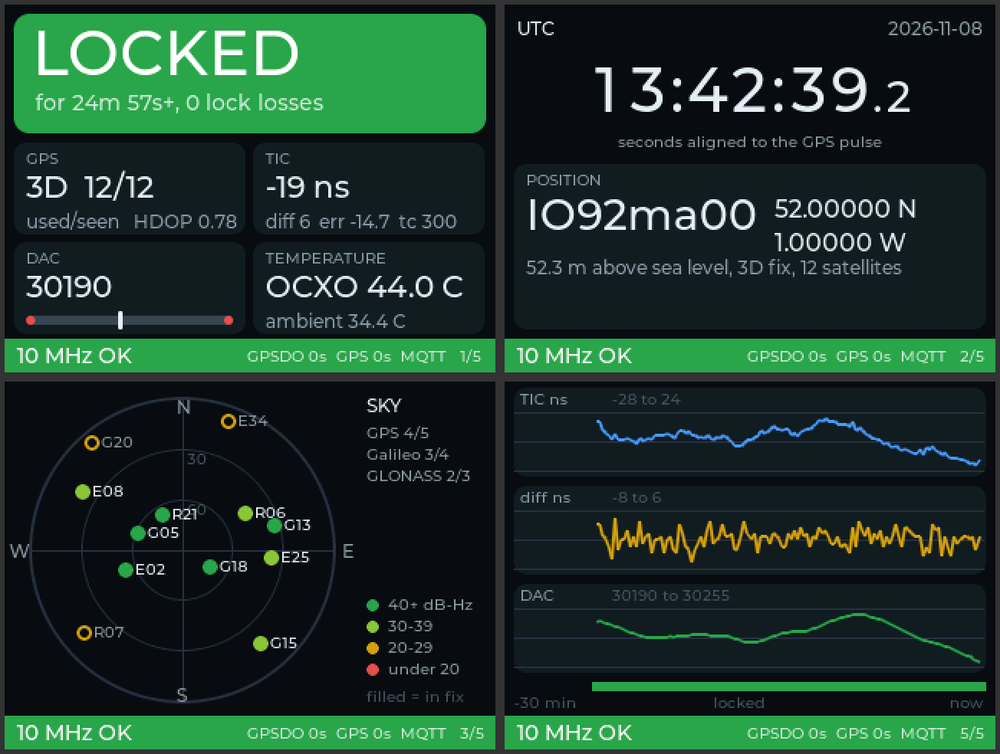

# gpsdo-cyd

A desk display for a Lars Walenius / PaulV GPSDO, built on the ESP32-2432S028R "Cheap Yellow Display" (CYD).

It listens to two serial lines inside the GPSDO, the Arduino Nano's once-a-second report and the u-blox GPS module's NMEA, and shows whether the 10 MHz reference can be trusted. It never transmits to either device. If you give it Wi-Fi details it also publishes the state over MQTT, with Home Assistant discovery.



*Status: running on a real CYD (two-USB board, ILI9341 panel) with the GPSDO report relayed over USB; the taps are not wired yet.*

## Why "reference OK" and not just "locked"

The GPSDO's own "Locked" only means its loop is tracking the GPS pulse. When the u-blox loses its fix it keeps sending pulses from its own crystal, and the GPSDO happily stays "Locked" to a drifting reference. That happened to GB7RDG in November 2026. So the display checks both: **reference OK** needs the GPSDO locked *and* the GPS reporting a good fix. If the GPSDO says locked while the GPS has no fix, the banner turns red and says **GPS LOST**.

## Screens

Tap anywhere for the next screen.

1. **Status.** A big coloured banner with the state, then GPS fix and satellites, the TIC reading, the DAC (with its usable range and the red end zones), and temperatures. During start-up and while locking, a bar shows progress.
2. **Time and position.** UTC to a tenth of a second (the second itself from the GPS messages, its start from the GPSDO's PPS-triggered report), the date, latitude and longitude, altitude and the 8-character Maidenhead locator. The position is only shown, never published.
3. **Sky.** Where the satellites are. Filled dots are used in the fix, rings are only in view; colour is signal strength.
4. **Signal.** Signal strength per satellite, strongest first.
5. **Trends.** The last 30 minutes of TIC, its rate of change, and DAC, with a strip showing when it was locked.

The bar along the bottom of every screen answers "can I trust the 10 MHz right now?": green **10 MHz OK** (GPSDO locked and the GPS has a good fix), amber **10 MHz UNCHECKED** (locked, but no GPS data to confirm it) or red **10 MHz UNRELIABLE**. It also shows how many seconds since each source last spoke, and the network state.

## What the banner means

| Banner | Colour | Meaning |
|---|---|---|
| LOCKED | green | GPSDO locked. The sub-line says for how long and how many lock losses since the display started. |
| GPS LOST | red | GPSDO says locked, but the GPS has no fix, too few satellites, or has gone quiet. Don't trust the reference. |
| UNLOCKED | amber | GPSDO not locked yet. Shows how far the TIC is from target and the soonest it could lock (5 x the time constant of good seconds). |
| NO PPS | red | No pulse from the GPS; the GPSDO is holding its last setting. |
| NO 10 MHz | red | The GPSDO cannot see its own oscillator. |
| HOLD / WARM UP | amber | Hold set by command, or the firmware's 5-minute start-up timer after the first PPS (a timer, not a temperature). |
| NO DATA | grey | Nothing from the GPSDO for more than 3 seconds. |

The DAC value turns red with "NEAR LIMIT" when it is below 3000 or above 62535: the oscillator is near the end of its tuning range.

## MQTT

Set it up from your phone. When no settings are saved, or when you hold a finger on the screen while it starts, the CYD runs a setup hotspot for 10 minutes and shows its name, a password and the address to open. The form asks for the Wi-Fi network and password and the MQTT broker (name or IP), port, username and password. When you submit, it joins the Wi-Fi, looks up the broker, connects and logs in, and only saves the settings if all of that works; otherwise it tells you which step failed. The broker's name is looked up again on every reconnect.

Without saved settings Wi-Fi stays off. Transmit power is capped at 2 dBm (`src/device/config.h`).

- `gpsdo/status`: `online` or `offline` (retained, offline is the last will).
- `gpsdo/state`: retained JSON, sent when the state changes and every 10 s. For example:

```json
{"state":"LOCKED","reference_ok":true,"locked":true,"locked_s":5400,"lock_losses":0,
 "tic_ns":-4,"dac":30242,"dac_near_limit":false,"ocxo_c":43.9,"diff_ns":-20,"tic_error_ns":17.9,
 "tc_s":300,"ambient_c":34.2,"gpsdo_age_s":0,"firmware":"Rev. 3.4 paulv mods  ID:0",
 "gps_seen":true,"fix":"3D","sats_used":11,"sats_in_view":14,"hdop":0.78,"gps_age_s":0,"alarms":[]}
```

`reference_ok` is the one field to act on. `alarms` can hold `gpsdo_silent`, `no_pps`, `no_10mhz`, `unlocked`, `dac_near_limit`, `gps_silent`, `gps_no_fix`, `gps_few_sats` and `reference_suspect`.

Home Assistant picks up a "GPSDO" device with Reference OK, Locked, State, TIC, TIC error, DAC, both temperatures, time locked, lock losses and satellites used.

## Build and flash

Uses [PlatformIO](https://platformio.org/).

```sh
pio test -e native              # parser and logic tests, including a real 25-minute capture
pio run -e cyd -t upload        # ILI9341 panel (most boards, ours included)
pio run -e cyd2usb -t upload    # ST7789 panel: use this if the colours look inverted
pio device monitor              # console: every received line, prefixed N> or G>
tools/render.sh                 # render the screens on a PC into docs/screens/
tools/replay.py /dev/ttyUSB0 captures/arduino-20261108.log   # drive a CYD from a capture
tools/bridge.py NANO_PORT CYD_PORT  # relay the GPSDO's own USB report into the CYD, before wiring
```

## Wiring

See [WIRING.md](WIRING.md). It plugs onto two headers already on the GPSDO board: J4 (the Nano's report, through a 10k/20k divider to IO35) and J1 (the GPS output, through 1k to IO22), plus ground, all into the CYD's P3. No soldering on the GPSDO. The CYD has its own USB power.

## Layout

- `lib/gpsdo_core`: parsers for the GPSDO report and NMEA, the monitor that combines them, and the MQTT JSON. Plain C++, tested on a PC.
- `lib/gpsdo_ui`: the LVGL screens.
- `src/device`: CYD firmware. `src/sim`: PC simulator.
- `captures/`: real captures used as test fixtures. `docs/plan.md`: the original plan.

## Licence

AGPL-3.0-or-later. See [LICENSE](LICENSE).
