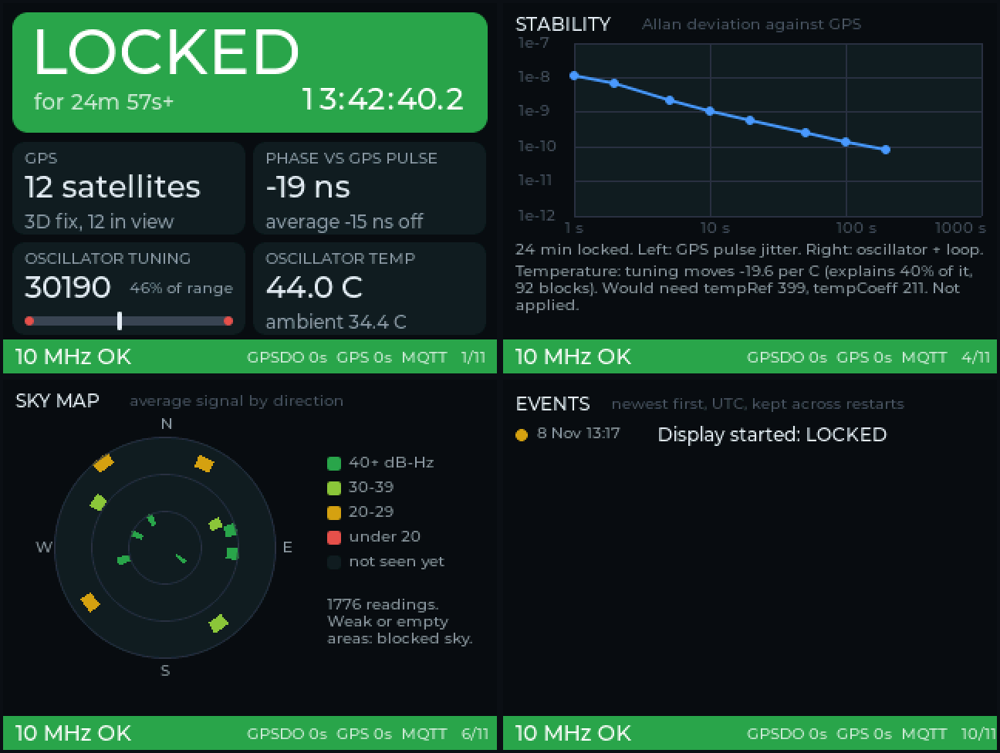

# gpsdo-cyd

A desk display for a Lars Walenius / PaulV GPSDO, built on the ESP32-2432S028R "Cheap Yellow Display" (CYD).

It listens to two serial lines inside the GPSDO, the Arduino Nano's once-a-second report and the u-blox GPS module's NMEA, and shows whether the 10 MHz reference can be trusted. It never transmits to either device. If you give it Wi-Fi details it also publishes the state over MQTT, with Home Assistant discovery.



*Status: in daily use on a real CYD (two-USB board, ILI9341 panel), wired to the GPSDO's taps and 1PPS, on Wi-Fi.*

## Why "reference OK" and not just "locked"

The GPSDO's own "Locked" only means its loop is tracking the GPS pulse. When the u-blox loses its fix it keeps sending pulses from its own crystal, and the GPSDO happily stays "Locked" to a drifting reference. That happened to GB7RDG in November 2026. So the display checks both: **reference OK** needs the GPSDO locked *and* the GPS reporting a good fix. If the GPSDO says locked while the GPS has no fix, the banner turns red and says **GPS LOST**.

## Screens

Tap anywhere for the next screen.

1. **Status.** A big coloured banner with the state and UTC to 0.1 s, then GPS satellites and fix, phase against the GPS pulse, oscillator tuning (with its usable range and the red end zones) and oscillator temperature. During start-up and while locking, a bar shows progress.
2. **Time and position.** UTC to a tenth of a second, the date, latitude and longitude, altitude and the 8-character Maidenhead locator. The position is only shown, never published.
3. **10 MHz accuracy.** The average frequency error over 1, 5 and 30 minutes in parts per billion, from the change in phase against the GPS pulse, and what the 30-minute figure means in hertz on 3.5 to 144 MHz.
4. **Stability.** The Allan deviation of the 10 MHz against GPS from 1 s to about 20 minutes, from up to an hour of continuous locked seconds, on a log-log plot. Short averaging times mostly show the GPS pulse's own jitter; longer ones show the oscillator and the loop. Below it, how the tuning has followed the oven temperature over the GPSDO's 18-day history, and the `tempRef`/`tempCoeff` that would compensate (shown only, never sent).
5. **Sky.** Where the satellites are. Filled dots are used in the fix, rings are only in view; colour is signal strength.
6. **Sky map.** Average signal strength by direction (10 by 10 degree cells), built up over days and kept across restarts. Weak or empty areas are where buildings or trees block the antenna's view.
7. **Signal.** Signal strength per satellite, strongest first, with the antenna status the GPS reports and the average of the best four over 24 hours (a slowly failing antenna or cable shows here first).
8. **Trends.** The last 30 minutes of phase, phase change per second and oscillator tuning, as 12-second averages, with a strip showing when it was locked.
9. **History.** 18 days of oscillator tuning and temperature and 12 hours of phase, read from the GPSDO's own memory: the end of each report line replays it, so the whole set arrives within 5 minutes of the display starting.
10. **Events.** Lock lost and regained, GPS fix lost, no PPS, GPSDO and GPS restarts, antenna faults, Wi-Fi and MQTT drops, with UTC times. Kept across restarts of the display.
11. **Network.** Wi-Fi, signal and channel, IP address, the NTP server's state, the MQTT broker and the address it was last looked up as, messages sent and the last error.

The bar along the bottom of every screen answers "can I trust the 10 MHz right now?": green **10 MHz OK** (GPSDO locked and the GPS has a good fix), amber **10 MHz UNCHECKED** (locked, but no GPS data to confirm it) or red **10 MHz UNRELIABLE**. It also shows how many seconds since each source last spoke, and the network state.

The backlight dims in a dark room (the CYD's light sensor), and if a small speaker is plugged into the CYD's P4 connector it beeps three times when the 10 MHz becomes unreliable and once when it recovers.

## GPS watch: jamming and spoofing

Using only what the GPS already reports, the display watches for:

- **Signal loss:** the four strongest satellites fall 10 dB or more below their usual level for 30 s (jamming, or the antenna or cable failing). Logged as an event.
- **Spoofing signs:** the position moves more than 100 m from where this fixed antenna normally is (learned over its first 30 minutes of good fixes, kept on the device only); the GPS time steps against the display's own count of seconds; or many satellites are all strong and suspiciously equal. Any of these turns the verdict red, because a spoofed GPS cannot discipline the oscillator.

After moving the antenna, type `forget position` on the console so it relearns.

## What the banner means

| Banner | Colour | Meaning |
|---|---|---|
| LOCKED | green | GPSDO locked. The sub-line says for how long and how many unlocks since the display started. |
| GPS LOST | red | GPSDO says locked, but the GPS has no fix, too few satellites, or has gone quiet. Don't trust the reference. |
| UNLOCKED | amber | GPSDO not locked yet. Shows how far the TIC is from target and the soonest it could lock (5 x the time constant of good seconds). |
| NO PPS | red | No pulse from the GPS; the GPSDO is holding its last setting. |
| NO 10 MHz | red | The GPSDO cannot see its own oscillator. |
| HOLD / WARM UP | amber | Hold set by command, or the firmware's 5-minute start-up timer after the first PPS (a timer, not a temperature). |
| NO DATA | grey | Nothing from the GPSDO for more than 3 seconds. |

The DAC value turns red with "NEAR LIMIT" when it is below 3000 or above 62535: the oscillator is near the end of its tuning range.

## MQTT

Set it up from your phone. When no settings are saved, or when you hold a finger on the screen while it starts, the CYD runs a setup hotspot for 10 minutes and shows its name, a password and the address to open. The form asks for the Wi-Fi network and password and the MQTT broker (name or IP), port, username and password. When you submit, it joins the Wi-Fi, looks up the broker, connects and logs in, and only saves the settings if all of that works; otherwise it tells you which step failed. The broker's name is looked up again on every reconnect.

Without saved settings Wi-Fi stays off. Transmit power is capped at 2 dBm (`src/device/config.h`).

- `gpsdo/status`: `online` or `offline` (retained, offline is the last will).
- `gpsdo/state`: retained JSON, sent when the state changes and every 10 s. For example:

```json
{"state":"LOCKED","reference_ok":true,"locked":true,"locked_s":5400,"lock_losses":0,
 "tic_ns":-4,"dac":30242,"dac_near_limit":false,"ocxo_c":43.9,"diff_ns":-20,"tic_error_ns":17.9,
 "tc_s":300,"ambient_c":34.2,"gpsdo_age_s":0,"firmware":"Rev. 3.4 paulv mods  ID:0",
 "gps_seen":true,"fix":"3D","sats_used":11,"sats_in_view":14,"hdop":0.78,"gps_age_s":0,"alarms":[]}
```

With our modified Nano firmware (`nano/`) the state also carries `lock_counter`, `lock_target`, `lock_test_tic_ns`, `lock_test_freq_ns`, `missed_pps_total` and `since_missed_pps_s`.

`reference_ok` is the one field to act on. `alarms` can hold `gpsdo_silent`, `no_pps`, `no_10mhz`, `unlocked`, `dac_near_limit`, `gps_silent`, `gps_no_fix`, `gps_few_sats` and `reference_suspect`.

The state also carries `pps_input`: true while the 1PPS wired to IO27 is giving edges.

Home Assistant picks up a "GPSDO" device with Reference OK, Locked, GPS interference, PPS input, State, phase, phase error, DAC, both temperatures, time locked, lock progress, lock losses, missed pulses, satellites used, 30-minute frequency error, antenna status and restart counts.

## Web page and names

Once on Wi-Fi the display serves a read-only web page. It asks for the name `gpsdo` when it gets its address, so on networks whose router registers DHCP names it is reachable as `gpsdo` (here **http://gpsdo.lan/**). There is no mDNS: the ESP32's mDNS responder crashed the display on a packet from another device. The page shows the verdict, the full event log, trends, the 18-day history, satellites and frequency error; the same data is JSON at `/api/state`, `/api/events`, `/api/trends`, `/api/history`, `/api/sats`, `/api/accuracy`, `/api/time`, `/api/stability`, `/api/skymap`, `/api/recordings`, `/api/network` and `/api/pps`. After a crash, `/api/crash` gives the crashing task, program counter and backtrace (decode with `xtensa-esp32-elf-addr2line` against the `firmware.elf` of the build that crashed).

## NTP server

Once on Wi-Fi, the CYD answers NTP on UDP port 123 as a stratum 1 server with reference "GPS". The second comes from the GPS messages and the start of each second from the GPSDO's 1PPS output, wired to IO27 and timestamped in its interrupt (see /api/pps). Without the PPS the CYD falls back to the Nano's report, which starts 3.15 ms after each PPS edge, timestamping its first byte in the UART's receive interrupt. Requests are timestamped in their own task as they arrive, and Wi-Fi power saving is off, because sleeping between beacons delays requests but not replies, which would show up as an offset.

It supports the interleaved mode (chrony `server gpsdo.lan iburst xleave`): a reply carries the time the previous reply actually left, taken after `sendto` returns, instead of an estimate made before sending. Measured 2026-11-16 from a wired LAN host, this put clients about 1.4 ms closer to true time than the basic mode (median offset -0.6 ms against -2.1 ms); the scatter is Wi-Fi's and is unchanged. When the GPS has no fix or the second marks stop, it replies with stratum 16 and the "not synchronised" flag, so clients ignore it.

The 1PPS comes from the GPSDO's front-panel BNC to IO27 (on CN1, through a 10k/20k divider for 5 V logic). On our unit that pulse is inverted (it falls on the second). The firmware finds which edge marks the second by itself, prefers it over the Nano's report, and reports the edge timing and the measured PPS-to-report delay at `/api/pps`; the event log notes the PPS input being found or lost.

## Build and flash

Uses [PlatformIO](https://platformio.org/).

```sh
pio test -e native              # parser and logic tests, including a real 25-minute capture
pio run -e cyd -t upload        # ILI9341 panel (most boards, ours included)
pio run -e cyd2usb -t upload    # ST7789 panel: use this if the colours look inverted
pio device monitor              # console: every received line, prefixed N> or G>
tools/render.sh                 # render the screens on a PC into docs/screens/
tools/replay.py /dev/ttyUSB0 captures/arduino-20261108.log   # drive a CYD from a capture
tools/bridge.py NANO_PORT CYD_PORT  # relay the GPSDO's own USB report into the CYD, before wiring
```

## Wiring

See [WIRING.md](WIRING.md), and [HARDWARE.md](HARDWARE.md) for what we found inside our unit. It plugs onto two headers already on the GPSDO board: J4 (the Nano's report, through a 10k/20k divider to IO35) and J1 (the GPS output, through 1k to IO22), plus ground, all into the CYD's P3. No soldering on the GPSDO. The CYD has its own USB power.

## Layout

- `lib/gpsdo_core`: parsers for the GPSDO report and NMEA, the monitor that combines them, and the MQTT JSON. Plain C++, tested on a PC.
- `lib/gpsdo_ui`: the LVGL screens.
- `src/device`: CYD firmware. `src/sim`: PC simulator.
- `captures/`: real captures used as test fixtures. `docs/plan.md`: the original plan.

## Licence

AGPL-3.0-or-later. See [LICENSE](LICENSE).
